# ambientCG: Tiles materials

**28 assets from [ambientCG](https://ambientcg.com), dedicated to the public domain under [CC0](https://docs.ambientcg.com/license/).** Use them in any game, free or paid, and change them however you like; no credit is needed.

PBR materials as 1K and 2K JPG maps (colour, normal GL and DX, roughness, AO, displacement), one folder per resolution. 891.6 MB in all.

This is a copy kept by [zuujis-cc0](https://github.com/zuujis-cc0) so game makers can take single files from GitHub. It is not made by or affiliated with ambientCG: the originals, often in more formats and higher resolutions, are on [ambientcg.com](https://ambientcg.com). If they help you, consider [supporting ambientCG](https://www.patreon.com/ambientCG).

Every file is listed in [MANIFEST.tsv](MANIFEST.tsv) with its size and SHA-256. More free assets: [the Zuujis collection](https://github.com/zuujis-cc0/free-game-assets#readme).

| | | | |
| :-: | :-: | :-: | :-: |
| <a href="Tiles070">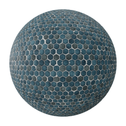</a> <b><a href="Tiles070">Tiles 070</a></b> by ambientCG · <a href="https://ambientcg.com/a/Tiles070">source</a> | <a href="Tiles071">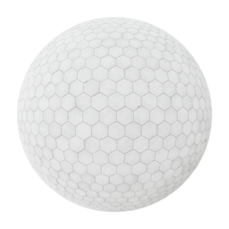</a> <b><a href="Tiles071">Tiles 071</a></b> by ambientCG · <a href="https://ambientcg.com/a/Tiles071">source</a> | <a href="Tiles072">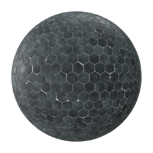</a> <b><a href="Tiles072">Tiles 072</a></b> by ambientCG · <a href="https://ambientcg.com/a/Tiles072">source</a> | <a href="Tiles073">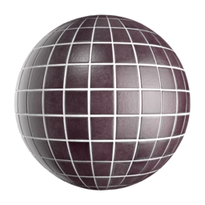</a> <b><a href="Tiles073">Tiles 073</a></b> by ambientCG · <a href="https://ambientcg.com/a/Tiles073">source</a> |
| <a href="Tiles074">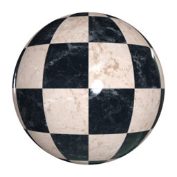</a> <b><a href="Tiles074">Tiles 074</a></b> by ambientCG · <a href="https://ambientcg.com/a/Tiles074">source</a> | <a href="Tiles075">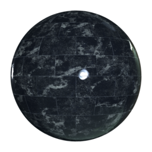</a> <b><a href="Tiles075">Tiles 075</a></b> by ambientCG · <a href="https://ambientcg.com/a/Tiles075">source</a> | <a href="Tiles076">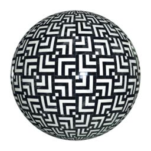</a> <b><a href="Tiles076">Tiles 076</a></b> by ambientCG · <a href="https://ambientcg.com/a/Tiles076">source</a> | <a href="Tiles077">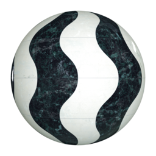</a> <b><a href="Tiles077">Tiles 077</a></b> by ambientCG · <a href="https://ambientcg.com/a/Tiles077">source</a> |
| <a href="Tiles078">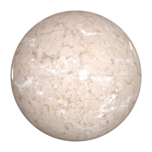</a> <b><a href="Tiles078">Tiles 078</a></b> by ambientCG · <a href="https://ambientcg.com/a/Tiles078">source</a> | <a href="Tiles079">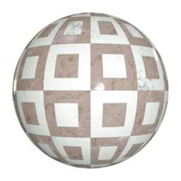</a> <b><a href="Tiles079">Tiles 079</a></b> by ambientCG · <a href="https://ambientcg.com/a/Tiles079">source</a> | <a href="Tiles080">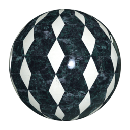</a> <b><a href="Tiles080">Tiles 080</a></b> by ambientCG · <a href="https://ambientcg.com/a/Tiles080">source</a> | <a href="Tiles081">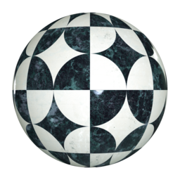</a> <b><a href="Tiles081">Tiles 081</a></b> by ambientCG · <a href="https://ambientcg.com/a/Tiles081">source</a> |
| <a href="Tiles082">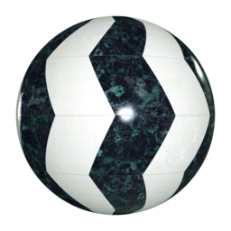</a> <b><a href="Tiles082">Tiles 082</a></b> by ambientCG · <a href="https://ambientcg.com/a/Tiles082">source</a> | <a href="Tiles083">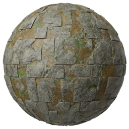</a> <b><a href="Tiles083">Tiles 083</a></b> by ambientCG · <a href="https://ambientcg.com/a/Tiles083">source</a> | <a href="Tiles084">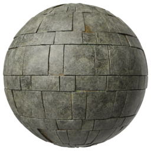</a> <b><a href="Tiles084">Tiles 084</a></b> by ambientCG · <a href="https://ambientcg.com/a/Tiles084">source</a> | <a href="Tiles085">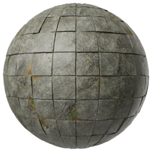</a> <b><a href="Tiles085">Tiles 085</a></b> by ambientCG · <a href="https://ambientcg.com/a/Tiles085">source</a> |
| <a href="Tiles086">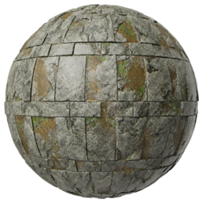</a> <b><a href="Tiles086">Tiles 086</a></b> by ambientCG · <a href="https://ambientcg.com/a/Tiles086">source</a> | <a href="Tiles087">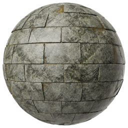</a> <b><a href="Tiles087">Tiles 087</a></b> by ambientCG · <a href="https://ambientcg.com/a/Tiles087">source</a> | <a href="Tiles088">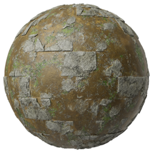</a> <b><a href="Tiles088">Tiles 088</a></b> by ambientCG · <a href="https://ambientcg.com/a/Tiles088">source</a> | <a href="Tiles089">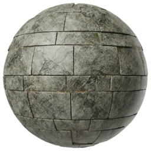</a> <b><a href="Tiles089">Tiles 089</a></b> by ambientCG · <a href="https://ambientcg.com/a/Tiles089">source</a> |
| <a href="Tiles090">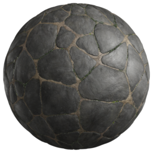</a> <b><a href="Tiles090">Tiles 090</a></b> by ambientCG · <a href="https://ambientcg.com/a/Tiles090">source</a> | <a href="Tiles091">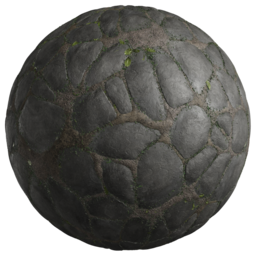</a> <b><a href="Tiles091">Tiles 091</a></b> by ambientCG · <a href="https://ambientcg.com/a/Tiles091">source</a> | <a href="Tiles092">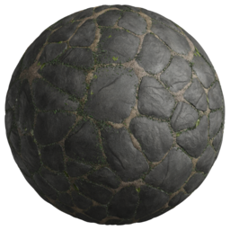</a> <b><a href="Tiles092">Tiles 092</a></b> by ambientCG · <a href="https://ambientcg.com/a/Tiles092">source</a> | <a href="Tiles093">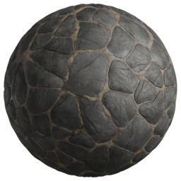</a> <b><a href="Tiles093">Tiles 093</a></b> by ambientCG · <a href="https://ambientcg.com/a/Tiles093">source</a> |
| <a href="Tiles094">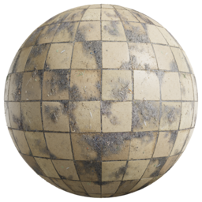</a> <b><a href="Tiles094">Tiles 094</a></b> by ambientCG · <a href="https://ambientcg.com/a/Tiles094">source</a> | <a href="Tiles095">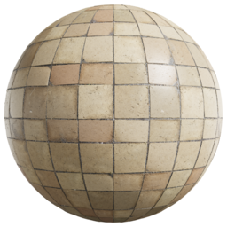</a> <b><a href="Tiles095">Tiles 095</a></b> by ambientCG · <a href="https://ambientcg.com/a/Tiles095">source</a> | <a href="Tiles096">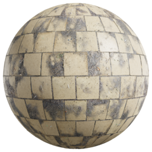</a> <b><a href="Tiles096">Tiles 096</a></b> by ambientCG · <a href="https://ambientcg.com/a/Tiles096">source</a> | <a href="Tiles097">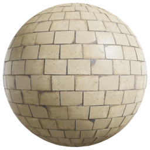</a> <b><a href="Tiles097">Tiles 097</a></b> by ambientCG · <a href="https://ambientcg.com/a/Tiles097">source</a> |

---

Kept up to date by this repository's own [update workflow](.github/workflows/update.yml), with code and plan from [cc0-mirror](https://github.com/zuujis-cc0/cc0-mirror). Something wrong? [Open an issue there](https://github.com/zuujis-cc0/cc0-mirror/issues/new) or use the [private report form](https://games.zuujis.com/report).
